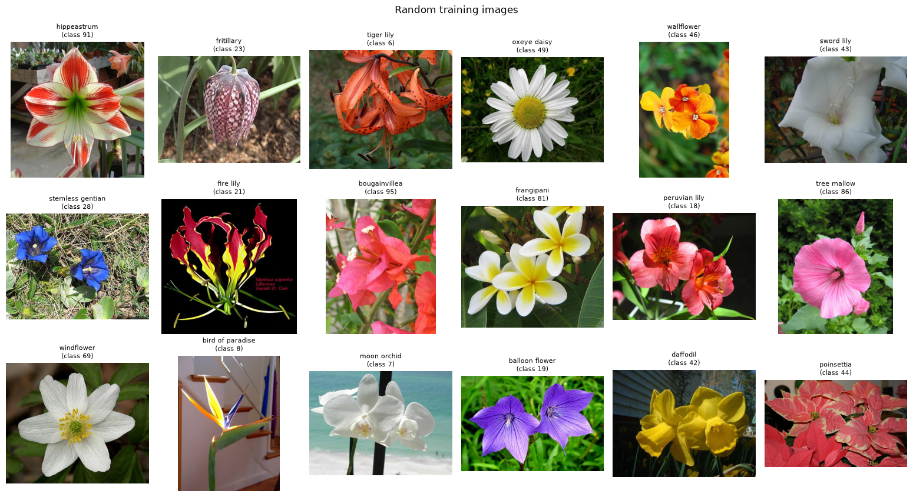
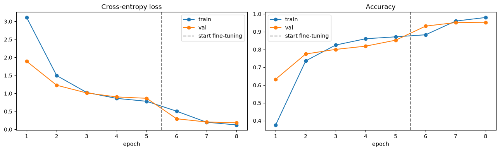
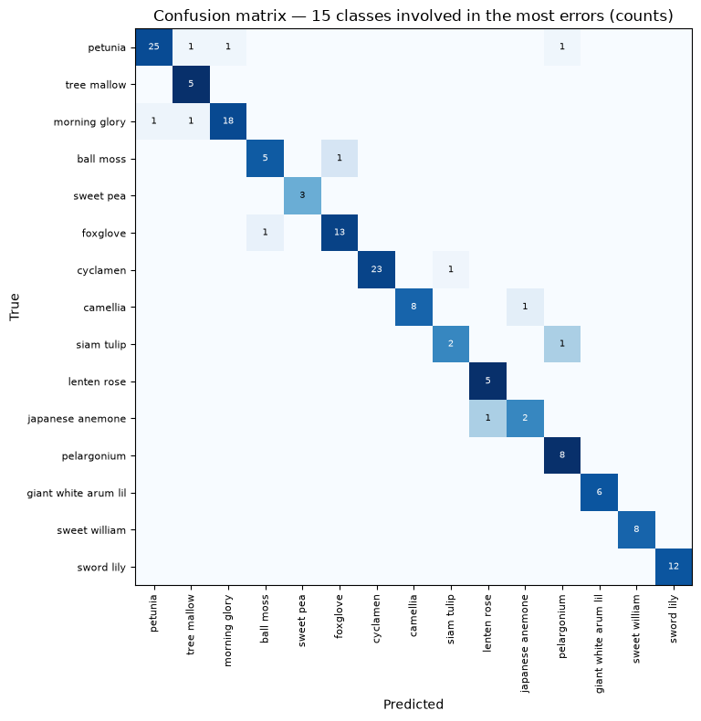
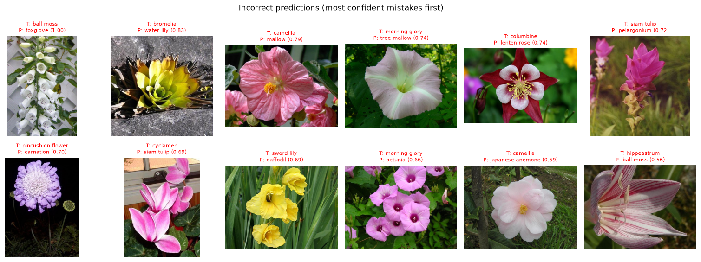

# Oxford 102 Flowers Classification

A complete transfer-learning **baseline** for fine-grained flower classification on the [Oxford 102 Flowers](https://www.robots.ox.ac.uk/~vgg/data/flowers/102/) dataset. The project is a single, documented Jupyter notebook covering every step: data exploration, preprocessing, training, evaluation and error analysis.

**Result:** an ImageNet-pretrained **ResNet-18**, trained for 8 epochs on a CPU, reaches **96.2% accuracy** and **99.4% top-5 accuracy** on 818 held-out images.



---

## Results

| Metric | Held-out test set (818 images) |
|---|---|
| Accuracy | **96.21%** |
| Top-5 accuracy | 99.39% |
| Macro precision | 94.99% |
| Macro recall | 96.49% |
| Macro F1 | 95.22% |
| Weighted F1 | 96.26% |
| Classes with perfect F1 | 64 / 102 |

Training took about 35 minutes on a laptop CPU (no GPU).

| Learning curves | Confusion matrix (15 most-confused classes) |
|---|---|
|  |  |

Most of the gain comes from **fine-tuning**. Validation accuracy is 85.2% after training only the new head and rises to 95.3% once the last ResNet block is unfrozen (the dashed line marks the switch).

---

## Approach

| Step | What the notebook does |
|---|---|
| **1. Problem definition** | 102-class, single-label, fine-grained image classification |
| **2. Exploration** | Detects the dataset layout automatically. Reports class distribution (24–185 training images per class, 7.7× imbalance), image sizes and sample images. |
| **3. Preprocessing** | Train: `RandomResizedCrop(224)`, flip, ±20° rotation, mild colour jitter. Eval: `Resize(256)` → `CenterCrop(224)`. ImageNet normalisation for both. |
| **4. Model** | ImageNet-pretrained ResNet-18 with a new 102-way linear head. `resnet50` and `efficientnet_b0` are one config change away. |
| **5. Training** | **Stage 1:** frozen backbone, train the head only (5 epochs, LR 1e-3). **Stage 2:** unfreeze `layer4` too (3 epochs, LR 1e-4). AdamW, cosine LR schedule, best checkpoint chosen by validation accuracy. |
| **6. Evaluation** | Accuracy, top-5, macro/weighted precision, recall and F1, per-class table, confusion matrices, correct and incorrect examples |
| **7. Error analysis** | Most-confused class pairs, side-by-side comparisons, confidence analysis, F1 against class size |
| **8. Next steps** | Ranked list of improvements, with the notebook locations to change |

### Data splits

In this copy of the dataset, `test/` is **unlabeled**, so it can't be used to measure accuracy. The notebook therefore uses:

| Role | Source | Images |
|---|---|---|
| Train | `train/` minus a stratified 10% | 5,895 |
| Validation (model selection) | stratified 10% of `train/` | 657 |
| **Test (reported metrics)** | `valid/` | 818 |
| Inference only | `test/` → `outputs/unlabeled_predictions.csv` | 819 |

The notebook detects this layout itself. If `test/` contains class sub-folders, it uses `train/valid/test` directly.

---

## Error analysis highlights



* **31 of 818** test images are misclassified, and no class pair is confused more than once.
* **Mistakes have low confidence.** Mean confidence is 0.94 for correct predictions and 0.50 for wrong ones. Predictions with confidence ≥ 0.8 cover 86% of images and are **99.7%** accurate, which makes a confidence threshold useful for flagging images for human review.
* **The most confident "mistake" is a labeling error in the dataset.** The image labeled *ball moss* (top-left) is clearly a *foxglove*, which is what the model predicted with confidence 1.00.
* **The remaining confusions are between look-alike species**, for example *morning glory ↔ petunia*, *camellia → mallow*, *columbine → lenten rose* and *sword lily → daffodil*. These pairs share colour and petal shape.
* **Class size matters little.** The correlation between a class's training count and its F1 is only 0.16, so imbalance is not the main source of errors.

---

## Repository structure

```
.
├── flower_classification_baseline.ipynb   # the full pipeline (saved with outputs)
├── cat_to_name.json                       # class id (folder name) -> species name
├── requirements.txt
├── assets/                                # figures used in this README
├── outputs/                               # created by the notebook
│   ├── best_resnet18.pt                   #   best checkpoint (git-ignored, ~45 MB)
│   └── unlabeled_predictions.csv          #   predictions for test/
├── train/  valid/  test/                  # dataset images (git-ignored, see below)
└── README.md
```

---

## Getting started

### 1. Install dependencies

Python 3.10 or newer is recommended.

```bash
python -m venv .venv
# Windows: .venv\Scripts\activate    |    Linux/macOS: source .venv/bin/activate
pip install -r requirements.txt
```

For GPU training, install the CUDA build of PyTorch from [pytorch.org](https://pytorch.org/get-started/locally/) first. The notebook uses the GPU automatically when one is available.

### 2. Get the dataset

The images (~350 MB) are **not stored in this repository**. Download the Oxford 102 Flowers dataset and place it next to the notebook in this layout:

```
train/<class_id>/*.jpg     # class_id = 1 … 102, matching cat_to_name.json
valid/<class_id>/*.jpg
test/*.jpg                 # optional; labeled sub-folders are also supported
```

This `train/valid/test` + `cat_to_name.json` layout is the widely shared PyTorch version of the dataset (available on Kaggle). The original images and labels are on the [VGG website](https://www.robots.ox.ac.uk/~vgg/data/flowers/102/).

### 3. Run the notebook

```bash
jupyter notebook flower_classification_baseline.ipynb
```

Run all cells from top to bottom. All settings are in the configuration cell near the top:

| Setting | Default | Notes |
|---|---|---|
| `MODEL_NAME` | `"resnet18"` | `"resnet50"`, `"efficientnet_b0"` |
| `HEAD_EPOCHS` / `FINETUNE_EPOCHS` | 5 / 3 | Set `FINETUNE_EPOCHS = 0` to skip fine-tuning |
| `HEAD_LR` / `FINETUNE_LR` | 1e-3 / 1e-4 | |
| `QUICK_RUN` | `False` | `True` trains on a tiny subset for 1 epoch per stage, which checks the whole pipeline in about a minute |

The pretrained weights download automatically on the first run.

---

## Next steps

These are ordered roughly by expected gain per unit of effort. Section 8 of the notebook has the full list.

1. Fine-tune more layers (`layer3` and above) with discriminative learning rates and more epochs.
2. Try a stronger backbone: ResNet-50, EfficientNet-B3, ConvNeXt, or DINOv2/CLIP features.
3. Use stronger augmentation (`TrivialAugmentWide`, Mixup/CutMix) and label smoothing.
4. Use a higher input resolution (288–384 px) to capture fine-grained details.
5. Apply test-time augmentation and ensembling.
6. Audit labels: review high-confidence disagreements such as the *ball moss / foxglove* case.

---

## Acknowledgements

* Dataset: M.-E. Nilsback and A. Zisserman, *"Automated Flower Classification over a Large Number of Classes"*, ICVGIP 2008. [Project page](https://www.robots.ox.ac.uk/~vgg/data/flowers/102/).
* Pretrained weights: [torchvision](https://pytorch.org/vision/stable/models.html).

## License

The code in this repository is released under the [MIT License](LICENSE). The dataset images are subject to the terms of their original source.
